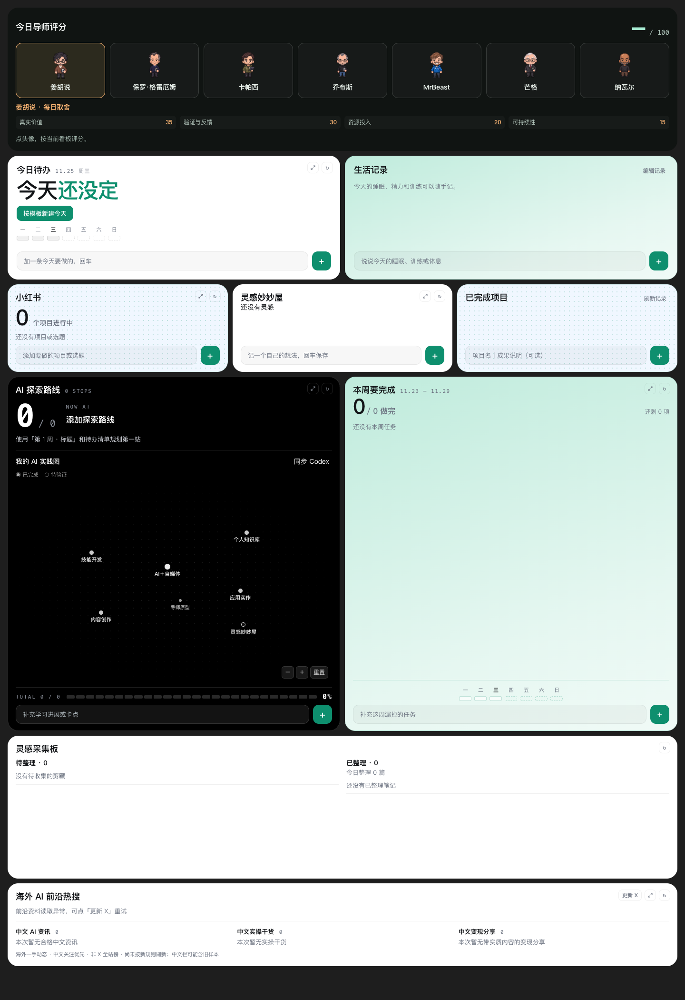

# Obsidian 工作看板

解压后在 Obsidian 桌面版选择「打开文件夹作为仓库」，打开包内目录。到社区插件安装并启用 Dataview，在它的设置打开 Enable JavaScript queries。再以阅读视图打开 `工作看板/工作看板.md`。各数据区从空白开始。

- 待办、日志、生活记录和本地资料浏览由 Obsidian 保存。
- 模型整理和 AI 初评需要已登录的 Codex CLI，且桌面程序能在 PATH 找到 codex。也可设置 BOARD_CODEX 为可执行文件路径。保留 GPT-5.6 Luna 和 GPT-6 Luna 默认设置，是否可用取决于使用者账户。
- 导师快评默认连接本机 3425 端口的 Magpie Responses 服务和 DeepSeek V4.1 Flash。需要自行部署并设置 BOARD_MENTOR_TOKEN（如服务要求）。
- Codex 汇总和手动 X 更新需要 Python 3，可设置 BOARD_PYTHON。X 用本机 OpenCLI 配合本人 Chrome 会话，或自己的 X_USER_ACCESS_TOKEN。聊天灵感同步需在 config.json 填自己的 ideasChatId 和 ideasSyncFrom（ISO 时间）。
- 七位导师默认启用，按各自评分维度提供模拟建议。如要引用额外人物技能，按导师配置中的路径自行安装。

界面沿用 ziyu-llm/obsidian-ai-dashboard 的 MIT 授权及本地改版，见界面目录 LICENSE。

## 空白看板预览

